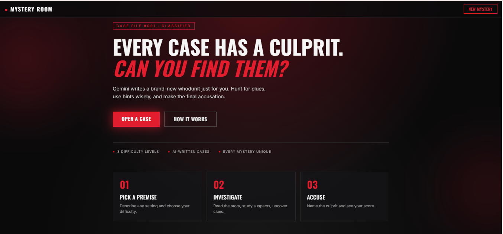
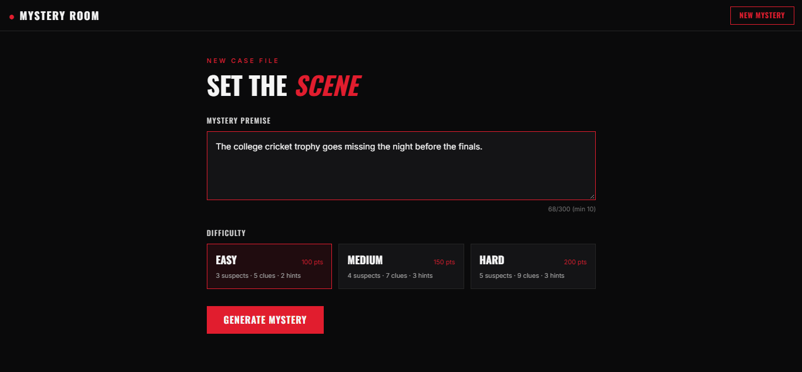
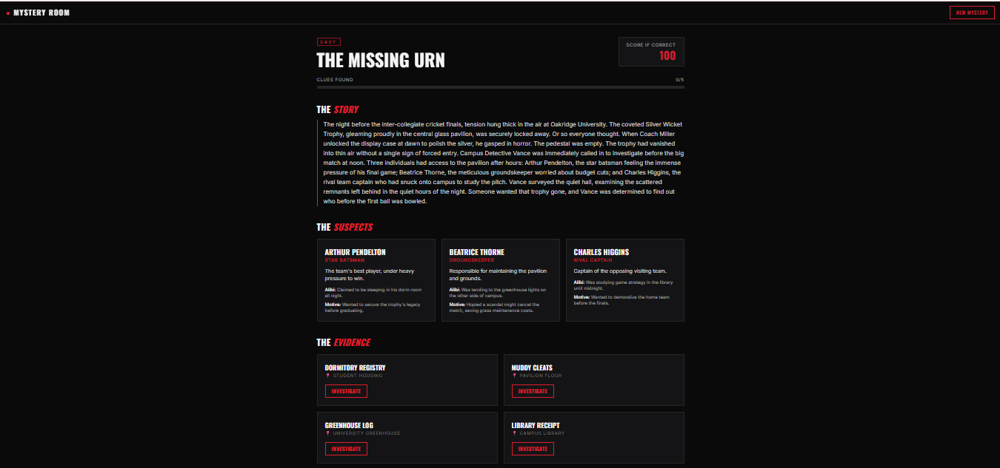
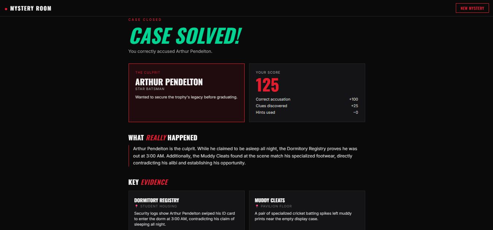

# 🕵️ AI Mystery Room

An AI-powered detective game. Type a premise, pick a difficulty, and Gemini writes a brand-new whodunit with suspects, clues and hints. Investigate, request hints, accuse the culprit, and get a score calculated by the backend.

**Live Demo:** https://ai-mystery-room-ashy.vercel.app
**API:** https://ai-mystery-room-1bgm.onrender.com/api/health
**Spec Sheet:** [SPEC.md](./SPEC.md)

> The API runs on a free Render instance, so the first request after a period of inactivity can take 30-60 seconds while the server wakes up.

## Screenshots

| Home | Create Mystery |
|---|---|
|  |  |

| Investigation Room | Result |
|---|---|
|  |  |

---

## Features

- Generate mysteries from any premise at **Easy / Medium / Hard**
- Investigation room with story, suspect cards, locked/unlocked clues and a progress bar
- Sequential hint system with a score penalty
- Final accusation with verdict, culprit reveal, full explanation and key evidence
- Animated score breakdown on the results page
- Cinematic red and black UI, responsive on mobile and desktop
- Loading and error states for every API-driven action

## Difficulty and Scoring

| Difficulty | Suspects | Clues | Hints | Correct accusation |
|---|---|---|---|---|
| Easy | 3 | 5 | 2 | 100 pts |
| Medium | 4 | 7 | 3 | 150 pts |
| Hard | 5 | 9 | 3 | 200 pts |

```
base        = correct ? 100 / 150 / 200 : 0
clueBonus   = 5  x discovered clues
hintPenalty = 10 x hints used
total       = max(0, base + clueBonus - hintPenalty)
```

All scoring happens on the backend. The client never sends a score.

## Tech Stack

| Layer | Tools |
|---|---|
| Frontend | React (Vite), Tailwind CSS, React Router, Axios |
| Backend | Node.js, Express, Zod |
| Database | MongoDB Atlas, Mongoose |
| AI | Google Gemini API (`@google/genai`) |
| Deployment | Vercel (frontend), Render (backend) |

## How It Works

1. `POST /api/cases` sends the premise and difficulty to Gemini, which returns structured JSON.
2. The response is validated with Zod and custom rules (exact counts, valid culprit, red herrings, no culprit name in hints, explanation references clues). Failed outputs are retried with the error fed back into the prompt.
3. If a Gemini model is overloaded (503/429), the server automatically falls back to the next model in the list.
4. The case is saved in MongoDB. The client only ever receives a **sanitized** version.

## Security: The Solution Stays on the Server

While a case is active, `solution` and each clue's `pointsTo` are stripped from every response. Undiscovered clues return only a title and location, and unrequested hints are not sent. `GET /api/cases/:id/result` returns `403` until an accusation has been submitted. Re-accusing or re-discovering a clue never changes the score.

## API Endpoints

| Method | Endpoint | Purpose |
|---|---|---|
| POST | `/api/cases` | Generate a mystery |
| GET | `/api/cases/:id` | Retrieve an active mystery (sanitized) |
| POST | `/api/cases/:id/clues/:clueId/discover` | Discover a clue |
| POST | `/api/cases/:id/hints` | Request the next hint |
| POST | `/api/cases/:id/accuse` | Submit an accusation |
| GET | `/api/cases/:id/result` | Retrieve the completed result |
| GET | `/api/health` | Health check |

Errors use a consistent shape: `{ "error": { "code": "STRING", "message": "..." } }`

## Project Structure

```
ai-mystery-room/
├── client/                 # React + Vite + Tailwind
│   └── src/
│       ├── pages/          # Home, Create, Investigation, Accuse, Result
│       ├── api.js          # Axios API layer
│       └── App.jsx         # Routes
├── server/
│   └── src/
│       ├── config/         # MongoDB connection
│       ├── models/         # Case schema
│       ├── routes/         # API routes
│       ├── services/       # Gemini, scoring, sanitizer
│       ├── validators/     # Zod schemas and mystery rules
│       └── index.js
└── SPEC.md
```

## Run Locally

**Prerequisites:** Node.js 18+, a MongoDB Atlas connection string, a Gemini API key.

```bash
git clone https://github.com/srisanjay-sj/ai-mystery-room.git
cd ai-mystery-room
```

**Backend**
```bash
cd server
npm install
```
Create `server/.env`:
```
PORT=5000
MONGODB_URI=your_mongodb_connection_string
GEMINI_API_KEY=your_gemini_api_key
GEMINI_MODEL=gemini-3.6-flash
CLIENT_URL=http://localhost:5173
```
```bash
npm run dev
```

**Frontend** (new terminal)
```bash
cd client
npm install
```
Create `client/.env`:
```
VITE_API_URL=http://localhost:5000/api
```
```bash
npm run dev
```

Open http://localhost:5173

## Deployment

- **Backend (Render):** root directory `server`, build `npm install`, start `npm start`, with the four environment variables above (`CLIENT_URL` set to the Vercel URL, no trailing slash).
- **Frontend (Vercel):** root directory `client`, with `VITE_API_URL` pointing to the Render API. `vercel.json` rewrites all routes to `index.html` for React Router.
- **Database:** MongoDB Atlas with network access allowed for the Render server.

## Author

**Srisanjay** · [GitHub](https://github.com/srisanjay-sj)

Built for the NxtWave "Build Your AI Mystery Room" project.
